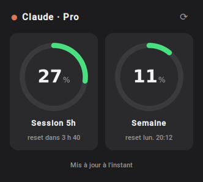
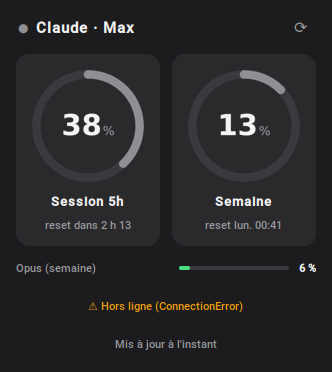
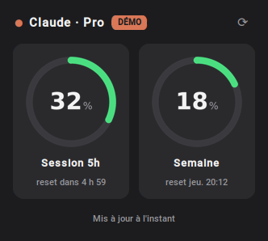

# Claude Usage Tray

Petite appli Windows, sobre, qui vit dans la zone de notification et affiche l'utilisation
de ton abonnement Claude (Pro / Max) : la **session 5 h** et le **quota hebdomadaire**,
avec leurs heures de reset. Ce sont les mêmes chiffres que `/usage` dans Claude Code.

<p align="center">
  
  &nbsp;
  
</p>
<p align="center"></p>

- **Icône** : un anneau qui se remplit (vert < 60 %, orange < 85 %, rouge au-delà), avec le % au centre.
- **Clic gauche** : mini-fenêtre avec les deux jauges et le compte à rebours avant reset. Une ligne « Opus (semaine) » s'ajoute en bas uniquement sur les offres **Max**, qui ont un quota hebdo séparé pour Opus. Sur **Pro**, elle n'apparaît pas.
- **Clic droit** : Rafraîchir, choix de la valeur affichée dans l'icône (session, semaine ou la plus élevée), lancement au démarrage de Windows, Quitter.
- **Notifications** quand la session ou la semaine dépasse 80 % puis 95 %.
- Survole l'icône pour un résumé dans l'infobulle.

## Installation

1. **Connecte Claude Code une fois.** L'appli réutilise sa connexion. L'appli Claude Desktop ne suffit pas :
   son jeton n'est pas lisible par d'autres programmes. Dans PowerShell :
   ```powershell
   irm https://claude.ai/install.ps1 | iex
   claude          # tape /login, connecte-toi, puis /exit
   ```
2. **Télécharge `ClaudeTracker-<version>-Setup.exe`** depuis la page
   [Releases](https://github.com/valentin1628/claude-win-tracker/releases/latest) et lance-le.
   Pas besoin d'être administrateur : l'appli s'installe dans `%LOCALAPPDATA%\Programs\ClaudeTracker`.
   Tu peux cocher « Lancer au démarrage de Windows ».

> **SmartScreen** affiche « Windows a protégé votre ordinateur » : l'exe n'est pas signé (un certificat
> coûte cher). Clique sur **Informations complémentaires**, puis **Exécuter quand même**.

Si tu n'utilises pas Claude Code au quotidien, active le renouvellement automatique du jeton (voir
[À propos du jeton](#à-propos-du-jeton)) :
```powershell
New-Item -ItemType Directory -Force "$env:APPDATA\ClaudeTracker" | Out-Null
'{"auto_refresh_token": true}' | Set-Content "$env:APPDATA\ClaudeTracker\config.json"
```

L'appli se trouve dans le menu Démarrer : **Claude Usage Tray**, plus **Claude Usage Tray - diagnostic** en cas de souci.
On la désinstalle depuis Paramètres → Applications.

## Mises à jour

L'appli vérifie toute seule, au démarrage puis toutes les 12 h, si une nouvelle version est publiée sur GitHub.
Si c'est le cas, une notification apparaît et le menu (clic droit sur l'icône) propose
**Installer la mise à jour vX.Y.Z**. Un clic télécharge l'installeur, vérifie son empreinte SHA-256,
l'installe en silence et relance l'appli. **Rechercher les mises à jour** force la vérification.

Pour désactiver la vérification : `"check_updates": false` dans `config.json`.

## Développement (depuis les sources)

Prérequis : [Python 3.10+](https://www.python.org/downloads/) et [Git](https://git-scm.com/download/win).
Les commandes se tapent dans un PowerShell **normal** (pas en administrateur).

```powershell
New-Item -ItemType Directory -Force "$env:USERPROFILE\Dev" | Out-Null
cd "$env:USERPROFILE\Dev"
git clone https://github.com/valentin1628/claude-win-tracker.git
cd claude-win-tracker
py -3 -m venv .venv
.\.venv\Scripts\activate
python -m pip install -e .[dev]
```

> Si `activate` affiche une erreur à propos des scripts : `Set-ExecutionPolicy -Scope CurrentUser RemoteSigned`, puis relance-le.

```powershell
.\.venv\Scripts\claude-tracker.exe   # lance l'appli sans console
python -m claude_tracker            # avec la console (pratique pour voir les erreurs)
python -m claude_tracker --demo     # fausses données, pour voir le rendu
python -m claude_tracker --check    # diagnostic de la connexion
git pull                            # mettre à jour les sources
```

En mode sources, la vérification des mises à jour est désactivée : c'est `git pull` qui fait le travail.

### Mode démo ou vraies données ?

`--demo` affiche des **valeurs inventées** qui montent de 3 % à chaque actualisation. Le popup porte alors
un badge orange **DÉMO** et l'infobulle commence par `[Démo]`. Sans option (ou avec l'appli installée),
ce sont tes vrais chiffres : l'offre affichée (« Claude · Pro ») vient de ton compte, et les %
correspondent à `/usage` dans Claude Code.

<p align="center"></p>

### Construire l'installeur en local

```powershell
winget install JRSoftware.InnoSetup   # une seule fois
.\build.ps1
```

Le script lance les tests, construit l'appli avec PyInstaller (`dist\ClaudeTracker\`), puis produit
l'installeur `dist\ClaudeTracker-<version>-Setup.exe` avec Inno Setup.

### Publier une version

1. Change `__version__` dans `src/claude_tracker/__init__.py` (par exemple `0.2.0` → `0.2.1`).
2. Fusionne dans `main`.

Le workflow GitHub Actions (`.github/workflows/release.yml`) lance alors les tests, construit l'installeur
sur un runner Windows et publie la release `v0.2.1`. Les applis installées la détectent ensuite toutes seules.
Sur une pull request, le workflow construit l'installeur sans le publier : tu peux le télécharger dans les
artefacts du run pour le tester.

## Ça ne remonte rien ?

Lance le diagnostic : raccourci **Claude Usage Tray - diagnostic** dans le menu Démarrer. En mode sources,
utilise `python -m claude_tracker --check` (venv activé).

Il vérifie chaque étape : fichier du jeton, expiration, appel à l'API et chiffres reçus. Il indique
aussi quoi faire si une étape échoue. Le jeton n'est jamais affiché.
Les causes les plus fréquentes :
- **Claude Code n'est pas installé ou connecté sur ce PC** : lance `claude` puis `/login`. Utiliser seulement claude.ai dans le navigateur ne suffit pas.
- **Le jeton a expiré** : lance `claude` une fois pour qu'il le renouvelle.
- **Proxy ou inspection HTTPS** (réseau d'entreprise) : l'erreur SSL s'affiche dans le diagnostic.

## Réglages

Le fichier de réglages est `%APPDATA%\ClaudeTracker\config.json`. Il est créé dès que tu changes une option dans le menu. Il n'est pas touché par les mises à jour.

```json
{
  "poll_seconds": 120,
  "icon_metric": "five_hour",
  "notify_thresholds": [80, 95],
  "auto_refresh_token": false,
  "check_updates": true
}
```

| Clé | Rôle |
|---|---|
| `poll_seconds` | Intervalle de rafraîchissement (60 s minimum). |
| `icon_metric` | Valeur affichée dans l'icône : `five_hour`, `seven_day` ou `max` (la plus élevée). |
| `notify_thresholds` | Seuils (en %) qui déclenchent une notification. |
| `auto_refresh_token` | Quand le jeton expire, l'appli le renouvelle elle-même (voir plus bas). |
| `check_updates` | Vérifie les nouvelles versions sur GitHub (appli installée uniquement). |

### À propos du jeton

Le jeton de Claude Code expire au bout de quelques heures et Claude Code le renouvelle à chaque utilisation.
Par défaut, si le jeton a expiré, l'appli passe en gris et affiche un bouton **Se reconnecter à Claude**
(également dans le menu clic droit). Il ouvre un PowerShell qui lance `claude` : Claude Code renouvelle le jeton,
ou te demande de te reconnecter s'il ne peut pas. Ferme la fenêtre une fois fini : l'appli se rafraîchit aussitôt.

Avec `auto_refresh_token: true`, l'appli renouvelle le jeton elle-même et réécrit le fichier.
C'est pratique si tu n'utilises pas Claude Code tous les jours. L'inconvénient : une session Claude Code
déjà ouverte au même moment peut devoir se reconnecter.

## Fonctionnement

```
src/claude_tracker/
├─ usage_client.py  # lecture du jeton + appel GET /api/oauth/usage, parsing tolérant
├─ render.py        # anneaux dessinés avec Pillow (supersampling x4 → anti-aliasing)
├─ popup.py         # fenêtre customtkinter sans bordure, au-dessus de la barre des tâches
├─ app.py           # Tk (thread principal) + pystray + thread de polling, reliés par une file
├─ formatting.py    # textes FR : « reset dans 2 h 14 », infobulle…
├─ config.py        # réglages JSON
├─ updater.py       # vérifie la dernière release GitHub, télécharge et lance l'installeur
├─ diagnose.py      # --check
└─ autostart.py     # clé de registre HKCU\…\Run
installer/ClaudeTracker.iss   # installeur Inno Setup (sans droits admin)
.github/workflows/release.yml # CI : tests, build Windows, publication des releases
```

L'endpoint `api.anthropic.com/api/oauth/usage` est celui qu'utilise Claude Code. Il n'est **pas documenté
officiellement** et peut donc changer. Tout ce qui dépend de son format est regroupé dans `usage_client.py`.

Pour regénérer les aperçus des icônes : `python -m claude_tracker.render --preview preview`.

## Tests

```powershell
pytest
```
