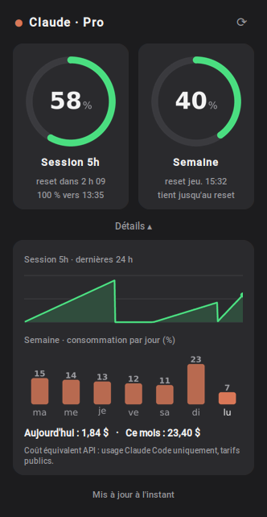
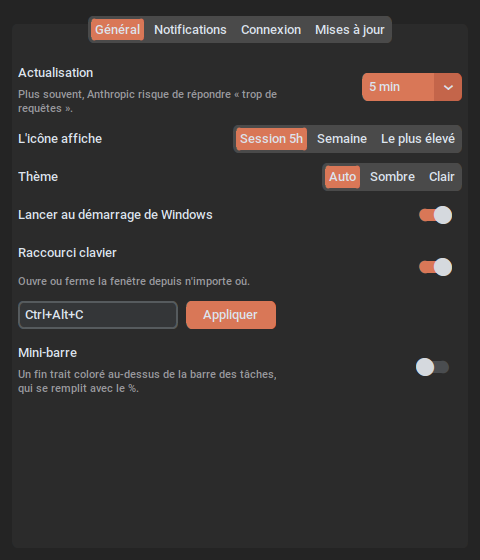

# Claude Usage Tray

Une petite icône à côté de l'horloge Windows (ou dans la barre de menus du Mac) qui te dit où tu en es de ton abonnement Claude (Pro ou Max).

Claude limite l'utilisation de deux façons : une **session de 5 heures** et un **quota par semaine**. Quand tu arrives au bout, il faut attendre. Cette appli te montre en permanence combien tu as consommé, et dans combien de temps ça se recharge. Plus besoin d'aller vérifier sur le site.

<p align="center">
  
</p>

> Projet personnel, non officiel. Il n'est ni fait ni soutenu par Anthropic (l'entreprise derrière Claude).

---

## Ce qu'il te faut

- Un PC sous **Windows 10 ou 11**, ou un **Mac à puce Apple** (M1, M2, M3, M4…) sous macOS 13 ou plus récent. Pour le Mac, [c'est par ici](#sur-mac).
- Un abonnement **Claude Pro ou Max**.
- **Claude Code** installé et connecté à ton compte. On le fait ensemble juste en dessous, c'est gratuit avec ton abonnement.

Pourquoi Claude Code ? L'appli ne te demande jamais ton mot de passe. Elle réutilise la connexion que Claude Code garde sur ton PC. L'appli Claude « classique » (Claude Desktop) ou le site claude.ai ne suffisent pas : leur connexion n'est pas lisible par un autre programme.

---

## Installation

### Étape 1 : installer et connecter Claude Code

1. Ouvre le menu Démarrer, tape **PowerShell** et lance-le. Pas besoin du mode administrateur.
2. Copie cette ligne, colle-la dans la fenêtre (clic droit pour coller), puis appuie sur Entrée :
   ```powershell
   irm https://claude.ai/install.ps1 | iex
   ```
3. Quand c'est fini, tape `claude` puis Entrée.
4. Dans Claude Code, tape `/login` puis Entrée. Ton navigateur s'ouvre : connecte-toi avec ton compte Claude.
5. Une fois connecté, tape `/exit` pour quitter. Tu peux fermer PowerShell.

Tu n'auras plus besoin d'y toucher.

### Étape 2 : installer l'appli

1. Va sur la page des [téléchargements](https://github.com/valentin1628/claude-win-tracker/releases/latest).
2. Dans la partie **Assets**, clique sur le fichier `ClaudeTracker-...-Setup.exe` pour le télécharger.
3. Lance-le.

Windows va probablement afficher un écran bleu « Windows a protégé votre ordinateur ». C'est normal : l'appli n'est pas « signée », parce qu'un certificat de signature coûte plusieurs centaines d'euros par an. Clique sur **Informations complémentaires**, puis sur **Exécuter quand même**.

4. Suis l'installation. Je te conseille de cocher **Lancer au démarrage de Windows**.

Pas besoin d'être administrateur. Une fois l'installation finie, l'icône apparaît près de l'horloge.

C'est tout. La connexion de Claude Code expire toutes les quelques heures (et après un redémarrage du PC), mais l'appli la renouvelle toute seule, exactement comme le fait Claude Code. Tu n'as pas besoin d'ouvrir Claude Code pour que les chiffres restent à jour.

---

## Sur Mac

Sur Mac, l'appli vit dans la **barre de menus**, en haut à droite, comme la batterie ou le Wi-Fi : une petite jauge verticale qui se remplit de bas en haut, avec le pourcentage à côté. Elle prend automatiquement la couleur de ta barre de menus (claire, sombre ou teintée par ton fond d'écran), et ne passe en rouge qu'à partir de 85 %. Pas d'icône dans le Dock.

- **Clic** sur la jauge : la fenêtre s'ouvre juste en dessous. Clique ailleurs pour la refermer.
- **Clic droit** (ou ctrl-clic) : le menu (Rafraîchir, Réglages, notifications, mises à jour, Quitter).

Le raccourci clavier et la mini-barre n'existent que sur Windows.

### Étape 1 : connecter Claude Code

L'appli lit la connexion que Claude Code enregistre dans le **Trousseau** du Mac. Si tu utilises déjà Claude Code dans le Terminal, il n'y a rien à faire.

Sinon, ouvre l'appli **Terminal** (Cmd + Espace, tape « Terminal ») et colle :

```bash
curl -fsSL https://claude.ai/install.sh | bash
```

Puis tape `claude`, ensuite `/login` dans Claude Code, connecte-toi dans le navigateur et quitte avec `/exit`.

> Claude Code intégré à l'appli Claude Desktop peut garder sa connexion à un autre endroit. Si l'appli affiche « Claude Code n'est pas connecté », fais l'étape ci-dessus une fois : elle ne gêne pas Claude Desktop.

### Étape 2 : installer l'appli

1. Sur la page des [téléchargements](https://github.com/valentin1628/claude-win-tracker/releases/latest), prends le fichier `ClaudeTracker-...-macOS-arm64.dmg`.
2. Ouvre-le et glisse **Claude Usage Tray** sur le dossier **Applications**.
3. Lance-la depuis le dossier Applications.

macOS va refuser de l'ouvrir la première fois, parce que l'appli n'est pas signée par Apple (ça coûte 99 $ par an). Pour l'autoriser, une seule fois :

- va dans **Réglages Système → Confidentialité et sécurité**, descends jusqu'au message sur « Claude Usage Tray » et clique sur **Ouvrir quand même** ;
- ou, plus rapide, colle ceci dans le Terminal :
  ```bash
  xattr -dr com.apple.quarantine "/Applications/Claude Usage Tray.app"
  ```

Pour qu'elle se lance toute seule : clic droit sur la jauge → **Lancer au démarrage**.

**Mises à jour sur Mac** : quand une version sort, une notification te prévient. Clic droit → **Installer la mise à jour** : le nouveau `.dmg` se télécharge et s'ouvre, l'appli se ferme. Glisse-la à nouveau dans Applications (**Remplacer**), puis relance-la.

**Diagnostic sur Mac** : dans le Terminal,
```bash
"/Applications/Claude Usage Tray.app/Contents/MacOS/Claude Usage Tray" --check
```
Il te dit où il a cherché la connexion (Trousseau ou fichier) et ce qui bloque.

**L'appli se ferme ou se fige** : son journal est dans `~/Library/Logs/ClaudeTracker/` (lisible avec l'appli **Console**). Envoie-le avec ta description du problème.

**Installe-la bien dans Applications** : glisse l'appli (pas le fichier `.dmg`) sur le raccourci Applications, puis éjecte le disque. Lancée depuis le `.dmg` ouvert, macOS la traite comme une appli sur disque externe.

**Désinstaller** : clic droit → Quitter, puis mets l'appli à la corbeille. Les réglages sont dans `~/Library/Application Support/ClaudeTracker`.

---

## Utilisation

**L'icône** affiche le pourcentage utilisé de ta session de 5 heures. L'anneau change de couleur :

| Couleur | Signification |
|---|---|
| Vert | moins de 60 % utilisés, tranquille |
| Orange | entre 60 et 85 %, ça commence à monter |
| Rouge | plus de 85 %, bientôt la limite |
| Gris | pas de données (pas de connexion, ou connexion expirée) |

<p align="center"></p>

**Passe la souris dessus** pour avoir un résumé rapide.

**Clic gauche** : ouvre la petite fenêtre avec deux jauges, la session 5 h et la semaine, et l'heure à laquelle chacune se recharge. Clique ailleurs pour la fermer.

**Clic droit** : le menu, avec :
- **Rafraîchir** : met à jour les chiffres tout de suite. Sinon, ils se mettent à jour seuls toutes les 5 minutes.
- **Réglages…** : la fenêtre où tout se règle (voir plus bas).
- **L'icône affiche** : choisir ce que montre l'icône (la session, la semaine, ou la plus haute des deux).
- **Notifications** : voir plus bas.
- **Lancer au démarrage** : pour que l'appli se lance avec Windows.
- **Quitter**.

Sur les abonnements Max, une ligne « Opus (semaine) » peut apparaître en bas de la fenêtre : c'est un quota séparé pour le modèle Opus. Sur Pro, elle n'apparaît pas.

### Prévision

Sous chaque jauge, l'appli estime où tu vas à ton rythme actuel :
- **« 100 % vers 15:40 »** : si tu continues comme ça, tu atteindras la limite à cette heure-là.
- **« tient jusqu'au reset »** : à ce rythme, tu n'atteindras pas la limite avant la recharge.

La prévision se base sur la dernière heure pour la session, et sur les dernières 24 heures pour la semaine. Il lui faut une dizaine de minutes de relevés avant de s'afficher.

### Détails

Le bouton **Détails ▾** en bas de la fenêtre déplie :
- la courbe de ta session sur les dernières 24 heures ;
- ta consommation de la semaine, jour par jour ;
- le **coût équivalent API** : ce que ton usage de Claude Code aurait coûté au tarif public de l'API, aujourd'hui et ce mois-ci. Seul Claude Code est compté (claude.ai et Claude Desktop ne laissent pas de trace sur ton PC). Pratique pour voir si ton abonnement est rentable.

<p align="center"></p>

Tout reste sur ton PC : l'historique est enregistré dans `%APPDATA%\ClaudeTracker\history.db`, et le coût est calculé à partir des journaux que Claude Code garde déjà dans `%USERPROFILE%\.claude\projects`.

---

## Notifications

L'appli peut te prévenir quand tu dépasses un certain niveau, par exemple « Session 5h : 82 % utilisés · reset à 16:30 ».

Par défaut, tu es prévenu à **80 %** et à **95 %**. Tout se règle dans **clic droit → Notifications** :
- **Activées** : couper ou remettre toutes les notifications.
- **À 50 %, 75 %, 80 %, 90 %, 95 %, 100 %** : coche les paliers qui t'intéressent.
- **Pour la session 5h / Pour la semaine** : choisir quels quotas surveiller.
- **Quand la session est rechargée** : être prévenu quand ta session repart à zéro.
- **Si la limite approche à ce rythme** : être prévenu quand la prévision annonce la limite dans moins de 45 minutes (session) ou de 24 heures (semaine).
- **Tester une notification** : pour voir à quoi ça ressemble.

Tu n'es prévenu qu'une fois par palier, au moment où tu le dépasses.

---

## Réglages

**Clic droit → Réglages…** ouvre une fenêtre avec quatre onglets :
- **Général** : fréquence d'actualisation, ce que montre l'icône, thème (Auto, Sombre ou Clair), lancement au démarrage, raccourci clavier et mini-barre.
- **Notifications** : les mêmes options que dans le menu, en plus lisible.
- **Connexion** : le renouvellement automatique de la connexion, et un bouton **Tester la connexion** qui affiche le diagnostic.
- **Mises à jour** : ta version, et la recherche des mises à jour.

<p align="center"></p>

Quelques précisions :
- **Thème** : en « Auto », l'appli suit le mode clair ou sombre de Windows (Paramètres → Personnalisation → Couleurs). Le chiffre de l'icône s'adapte aussi à la couleur de la barre des tâches.
- **Raccourci clavier** : `Ctrl+Alt+C` par défaut ouvre ou ferme la fenêtre depuis n'importe où. Tu peux le changer (par exemple `Ctrl+Shift+U` ou `Win+F9`). Si une autre appli l'utilise déjà, une notification te prévient.
- **Mini-barre** : un trait de couleur de 3 pixels, collé au-dessus de la barre des tâches, qui se remplit avec ton pourcentage. Les clics passent au travers, et elle se cache pendant les jeux et vidéos en plein écran.

---

## Mises à jour

Tu n'as rien à faire. L'appli vérifie toute seule s'il existe une nouvelle version. Si oui, une notification apparaît. Fais **clic droit → Installer la mise à jour** : elle se télécharge, s'installe et l'appli redémarre. Une notification « Mise à jour installée : vX ✓ » confirme que tout s'est bien passé.

Tu peux aussi vérifier à la main avec **clic droit → Rechercher les mises à jour**.

---

## Problèmes fréquents

**Je ne vois pas l'icône.**
Windows cache souvent les nouvelles icônes. Clique sur la petite flèche **^** à côté de l'horloge : elle y est sûrement. Pour la garder toujours visible : Paramètres → Personnalisation → Barre des tâches → Autres icônes de la barre d'état système, puis active **Claude Usage Tray**.

**L'icône est grise juste après le démarrage du PC.**
Rien d'anormal : le réseau n'est pas toujours prêt quand l'appli démarre. Elle réessaie au bout de 15 secondes, puis de 30 secondes.

**L'icône est grise et la fenêtre dit « Connexion à Claude expirée ».**
L'appli n'a pas réussi à renouveler la connexion. Ça arrive si tu t'es déconnecté de Claude Code, ou si la connexion a été révoquée (changement de mot de passe, par exemple). Clique sur le bouton **Se reconnecter à Claude** dans la fenêtre. Une fenêtre PowerShell s'ouvre avec Claude Code : s'il te le demande, reconnecte-toi, puis tape `/exit` et ferme la fenêtre. L'appli se met à jour aussitôt.

**L'icône reste grise et je ne comprends pas pourquoi.**
Dans le menu Démarrer, lance **Claude Usage Tray - diagnostic**. Une fenêtre vérifie chaque étape et te dit laquelle bloque, et quoi faire. Elle n'affiche aucune information secrète, tu peux en faire une capture pour demander de l'aide.

**Je suis sur un PC de boulot et ça ne marche pas.**
Certains réseaux d'entreprise filtrent les connexions sécurisées. Le diagnostic te le dira avec une « erreur SSL ». Dans ce cas, il faut voir avec ton service informatique.

**Les chiffres ne sont pas les mêmes que sur claude.ai.**
L'appli se met à jour toutes les 5 minutes. Fais clic droit → Rafraîchir. Ce sont les mêmes chiffres que la commande `/usage` dans Claude Code.

**La fenêtre dit « Anthropic limite les actualisations ».**
Ce n'est pas une panne. Anthropic n'accepte qu'un certain nombre de demandes de chiffres dans un temps donné. Quand on dépasse, l'appli patiente toute seule (5 minutes, puis plus longtemps si ça se répète) et garde les derniers chiffres affichés. L'heure du prochain essai est indiquée en bas de la fenêtre. Pendant ce temps, le bouton Rafraîchir ne fait rien, pour ne pas aggraver le blocage. Si tu utilises aussi d'autres outils qui affichent ta consommation Claude, ils comptent dans la même limite.

---

## Désinstaller

Paramètres Windows → Applications → **Claude Usage Tray** → Désinstaller.

---

## Réglages avancés

Tous les réglages sont dans le fichier `%APPDATA%\ClaudeTracker\config.json`. Pour l'ouvrir, colle ce chemin dans la barre d'adresse de l'Explorateur de fichiers. Tout se change depuis la fenêtre **Réglages**, donc tu n'as normalement pas besoin d'y toucher.

| Réglage | À quoi ça sert | Par défaut |
|---|---|---|
| `poll_seconds` | Toutes les combien de secondes les chiffres sont mis à jour (minimum 60, mais en dessous de 300 Anthropic risque de bloquer) | `300` |
| `icon_metric` | Ce que montre l'icône : `five_hour` (session), `seven_day` (semaine) ou `max` | `five_hour` |
| `notifications_enabled` | Notifications activées | `true` |
| `notify_thresholds` | Paliers des notifications, en % | `[80, 95]` |
| `notify_session` / `notify_weekly` | Notifier pour la session / pour la semaine | `true` |
| `notify_recharge` | Notifier quand la session est rechargée | `false` |
| `notify_forecast` | Notifier quand la prévision annonce la limite bientôt | `false` |
| `auto_refresh_token` | L'appli renouvelle elle-même la connexion quand elle expire | `true` |
| `check_updates` | Rechercher les mises à jour | `true` |
| `theme` | `auto` (suit Windows), `dark` ou `light` | `auto` |
| `hotkey_enabled` / `hotkey` | Raccourci clavier global | `true` / `Ctrl+Alt+C` |
| `minibar` | Mini-barre au-dessus de la barre des tâches | `false` |

Après une modification, redémarre l'appli. Les mises à jour ne touchent pas à ce fichier.

Pour les curieux : quand la connexion expire, l'appli fait la même chose que Claude Code. Elle demande un nouveau jeton à Anthropic et l'enregistre dans le fichier de Claude Code, que les deux partagent. Si Claude Code l'a déjà renouvelé, l'appli réutilise simplement le sien. Avec `"auto_refresh_token": false`, l'appli ne touche jamais à ce fichier : il faudra alors ouvrir Claude Code (ou cliquer sur **Se reconnecter à Claude**) quand la connexion expire.

---

<details>
<summary><b>Pour les développeurs</b></summary>

### Comment ça marche

L'appli lit le jeton que Claude Code enregistre dans `%USERPROFILE%\.claude\.credentials.json`. Avec ce jeton, elle appelle `https://api.anthropic.com/api/oauth/usage`, c'est-à-dire le service qu'utilise la commande `/usage` de Claude Code. Il n'est pas documenté officiellement et peut donc changer. Tout ce qui en dépend est regroupé dans `usage_client.py`.

```
src/claude_tracker/
├─ usage_client.py   lecture du jeton et appel à l'API
├─ app.py            icône (pystray), fenêtre (Tk) et rafraîchissement en arrière-plan
├─ popup.py          la fenêtre (customtkinter)
├─ render.py         dessin des anneaux (Pillow)
├─ formatting.py     textes affichés
├─ config.py         réglages
├─ updater.py        mises à jour depuis les releases GitHub
├─ login.py          bouton « Se reconnecter »
├─ history.py        historique local (SQLite)
├─ forecast.py       prévision du rythme
├─ costs.py          coût équivalent API (journaux de Claude Code)
├─ settings_window.py  fenêtre de réglages
├─ theme.py          thème clair / sombre (registre Windows)
├─ hotkey.py         raccourci clavier global
├─ minibar.py        mini-barre
├─ diagnose.py       diagnostic (--check)
└─ autostart.py      lancement au démarrage
installer/ClaudeTracker.iss     installeur (Inno Setup)
.github/workflows/release.yml   build et publication automatiques
```

### Lancer depuis le code

Il faut [Python 3.10+](https://www.python.org/downloads/) et [Git](https://git-scm.com/download/win).

```powershell
git clone https://github.com/valentin1628/claude-win-tracker.git
cd claude-win-tracker
py -3 -m venv .venv
.\.venv\Scripts\activate
python -m pip install -e .[dev]

python -m claude_tracker            # lance l'appli
python -m claude_tracker --demo     # avec de fausses données (badge DÉMO)
python -m claude_tracker --check    # diagnostic dans la console
pytest                              # tests
```

Si `activate` est refusé : `Set-ExecutionPolicy -Scope CurrentUser RemoteSigned`.

### Construire l'installeur

```powershell
winget install JRSoftware.InnoSetup   # une seule fois
.\build.ps1                           # -> dist\ClaudeTracker-<version>-Setup.exe
```

### Construire l'appli Mac

Sur un Mac Apple Silicon :

```bash
./build_mac.sh            # -> dist/ClaudeTracker-<version>-macOS-arm64.dmg
```

### Publier une version

1. Change `__version__` dans `src/claude_tracker/__init__.py`.
2. Fusionne dans `main`.

GitHub Actions lance les tests, construit l'installeur sur Windows et le `.dmg` sur Mac, puis publie la release avec les deux. Les applis installées la proposent ensuite toutes seules. Sur une pull request, l'installeur est construit sans être publié : il est disponible dans les artefacts du build.

</details>
